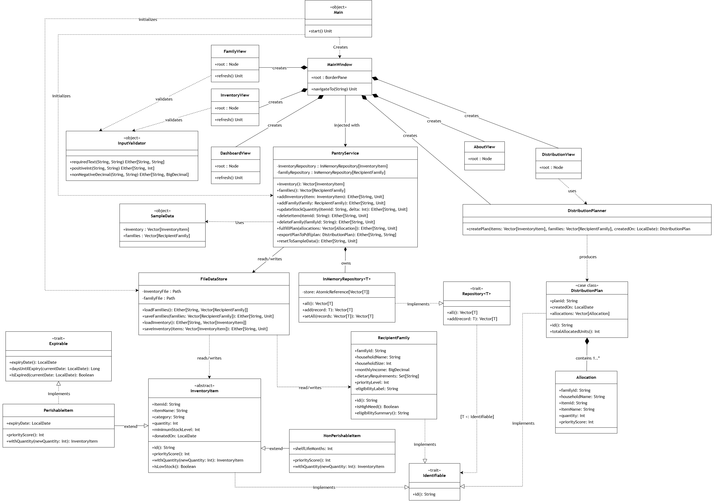

# PantryPulse — Food Pantry Inventory & Demand Management System

**Student Name:** Teoh En Yi 
**Student ID:** 23051105  
**Course Code:** PRG2104 Object-Oriented Programming  
**Academic Session:** 2026 Semester 2 — Final Project (Tier C — AI-Integrated)  
**Theme:** UN SDG Goal 1 — No Poverty  
**Sub-domain:** Food Pantry Inventory & Demand Allocation  

**Scala 3 · ScalaFX · JavaFX · CSV Storage · PDF Reports · ScalaTest**

---

## 1. Project Overview

**PantryPulse** is a standalone ScalaFX desktop application designed to support community food pantries and non-governmental aid organisations serving vulnerable, low-income households. By balancing inventory shelf life, stock levels, and household socio-economic urgency, the system generates transparent, data-driven daily distribution plans that minimize food waste and ensure equitable aid delivery.

### Key Features
1. **Dashboard & Low-Stock Alerts**: Real-time summary cards displaying stock metrics, immediate low-stock alert badges, and interactive inventory quick-search filtering.
2. **Inventory & Donation Logging**: Interactive entry form for perishable and non-perishable food donations with persistent CSV file storage across application restarts.
3. **Recipient Family Demand Register**: Household enrollment capturing family size, monthly income, dietary requirements, and assigned urgency levels.
4. **Automated Priority Distribution Planner**: Algorithmic matching module prioritizing expiring/low-stock inventory to highest-need households based on household size and urgency scores.

---

## From Donation to Distribution

<p align="center">
  <strong>A closer look at PantryPulse</strong><br>
  Food inventory, household priorities, and distribution planning in one desktop application.
</p>

<p align="center">
  <a href="https://drive.google.com/file/d/1cH00CDXoUzrNgYARG66lpKlEZsdyohJB/view?usp=drive_link"><strong>▶ WATCH THE DEMO</strong></a><br>
  <sub>Opens in Google Drive</sub>
</p>

| 01 · Record | 02 · Prioritize | 03 · Distribute |
| :--- | :--- | :--- |
| Log donated food and review stock levels. | Register households and assign priority levels. | Prepare allocations, export a PDF, and fulfill the plan. |

<details>
<summary><strong>Explore the application workflow</strong></summary>

1. Review dashboard metrics and low-stock alerts.
2. Add donated items and their stock details.
3. Register recipient households and set their priority.
4. Generate and review suggested allocations.
5. Export the PDF before fulfilling the plan and deducting stock.

</details>

*Academic prototype · Rule-based allocation*

---

## How Allocation Works

The current planner uses a simple, deterministic matching approach:

1. Keep inventory items with a quantity greater than zero.
2. Sort items by their calculated priority score, highest first.
3. Sort households by their assigned priority level, highest first.
4. Pair the two sorted lists in order.
5. Allocate the smaller of the item's available quantity and twice the household size, with a minimum of one unit.

Each matched household receives one item type per generated plan. The number of allocations is limited by the shorter list of households or available item records.

Perishable-item scores consider expiry dates and low-stock status. Non-perishable-item scores consider low-stock status. Monthly income and dietary requirements are recorded but are not used by the matching algorithm.

---

## 2. Requirements & Development Environment

| Component | Version / purpose |
| --- | --- |
| Scala | 3.3.6 |
| ScalaFX | 21.0.0-R32 |
| JavaFX | 21 |
| JDK | Java 21 recommended by the project |
| sbt | 1.12.14, pinned in `project/build.properties` |
| ScalaTest | 3.2.18 |
| OpenPDF | 1.3.38, for distribution reports |
| CSV files | Local inventory and household persistence |

### Requirements

- JDK 21 installed and available in your terminal.
- sbt installed.
- Internet access for the first dependency download.
- A desktop environment capable of displaying JavaFX windows.

---

## 3. How to Run the Application

### Compiling the Project cleanly (0 warnings under `-Wunused:all`)
```bash
sbt clean compile
```

### Launching the Graphical User Interface
```bash
sbt run
```

### Running Automated Unit Tests
```bash
sbt test
```
Run commands from the project root so the application uses the expected `data/` folder. Compilation, tests, and platform compatibility should be verified in your own environment; this README does not certify a successful run.

---

## 4. Architecture & OOP Highlights

* **Inheritance & Subtype Polymorphism**: `abstract class InventoryItem` extended by concrete subclasses `PerishableItem` and `NonPerishableItem`, overriding polymorphic `priorityScore` calculations.
* **Parametric Polymorphism**: Generic repository abstraction `trait Repository[T <: Identifiable]` implemented by `InMemoryRepository[T]`.
* **Immutability & Encapsulation**: Domain models strictly use immutable collections (`Vector`, `Set`) and `val` parameters. Encapsulated fields utilize explicit rationale comments.
* **Defensive Exception Handling**: All file IO and string parsing operations in `FileDataStore` and `InputValidator` are safely wrapped in `scala.util.Try` or `Either[String, T]`.
* **Reactive ScalaFX UI**: Modern card layout utilizing reactive `ObjectProperty`, `StringProperty`, and `ObservableBuffer` controls.

The application separates its responsibilities into layers:

| Layer | Responsibility |
| --- | --- |
| `model` | Inventory items, recipient families, allocations, and distribution plans |
| `repository` | Generic repository contracts and CSV persistence |
| `service` | Allocation rules, pantry operations, validation, and PDF generation |
| `traits` | Shared identity and expiry interfaces |
| `ui` | Dashboard, inventory, family, distribution, and about views |

Object-oriented concepts include an abstract `InventoryItem` model, perishable and non-perishable subclasses, overridden priority calculations, and a generic `Repository[T]` interface. Immutable domain snapshots and `Either`/`Try` error handling support the service and persistence layers.

---

### Class Diagram



## 5. Project Directory Structure

```text
Project_23051105/
├── build.sbt                          # Scala 3.3+, ScalaFX 21, ScalaTest
├── README.md                          # Setup, run commands, architecture summary
├── submission_manifest.md             # Checklist & metrics signed
├── .gitignore
│
├── ai/                                # AI Usage Documentation
│   ├── declaration.md                 # Signed Template 3
│   └── interaction_log.md             # Template 2 (>= 10 entries)
│
├── data/                              # CSV Persistence Storage
│   ├── distribution_plan.csv
│   ├── families.csv
│   └── inventory.csv
│
├── docs/                              # Deliverables
│   ├── UML.png                        # Class diagram (>= 5 classes)
│   ├── ai_reflection.md               # AI reflection essay (300-500 words)
│   ├── citations.md                   # Citations & licenses
│   ├── dev_log.md                     # >= 5 dated entries
│   └── reflection.md                  # Personal reflection (350-700 words)
│
├── project/
│   └── build.properties               # sbt version
│
└── src/
    ├── main/
    │   ├── resources/
    │   │   └── styles.css             # UI styling
    │   │
    │   └── scala/
    │       ├── Main.scala             # Entry point (extends JFXApp3)
    │       │
    │       ├── model/                 # Domain Models (Subtype Polymorphism)
    │       │   ├── DistributionPlan.scala
    │       │   ├── FamilyRequest.scala
    │       │   └── PantryItem.scala   # PerishableItem & NonPerishableItem
    │       │
    │       ├── repository/            # Data Access (Generic Repositories)
    │       │   ├── FileRepositories.scala
    │       │   └── Repository.scala   # Generic trait [T <: Identifiable]
    │       │
    │       ├── service/               # Business Logic
    │       │   ├── AllocationEngine.scala
    │       │   ├── SampleData.scala
    │       │   └── ValidationUtils.scala
    │       │
    │       ├── traits/                # Shared Interfaces
    │       │   ├── Expirable.scala
    │       │   └── Identifiable.scala
    │       │
    │       └── ui/                    # 4 Distinct Screens + Main Shell
    │           ├── DashboardView.scala    # Screen 1: Metrics & Low Stock
    │           ├── DistributionView.scala # Screen 2: Plan Generator & CSV Export
    │           ├── FamilyView.scala       # Screen 3: Beneficiary Household Registry
    │           ├── InventoryView.scala    # Screen 4: Donation Logging & Stock Table
    │           ├── MainWindow.scala       # Root Window Shell & Sidebar
    │           └── UiTheme.scala          # Design tokens & styles
    │
    └── test/
        └── scala/
            └── AllocationEngineSpec.scala # Unit tests
```

---

## 6. Data Storage Architecture Rationale

* **Runtime Writable Persistence (`./data/`)**: Live user edits, donations, and family enrollments persist dynamically to `data/inventory.csv` and `data/families.csv` at the project root. This enables reliable, writable file storage across application restarts (since files packaged under `src/main/resources/` become read-only assets in packaged builds).
* **Packaged Seed Data (`src/main/resources/data/`)**: Seed copies of `inventory.csv` and `families.csv` are maintained under `src/main/resources/data/`. The `FileDataStore` automatically falls back to loading these seed resources if the root `./data/` directory is not yet initialized.

---


## 7. AI Usage Summary

This project was developed under the PRG2104 **Tier C (AI-Integrated)** policy. AI assistance (Claude / Gemini) was leveraged for iterative code structure optimization, ScalaFX layout styling, and defensive validation logic. Every prompt, response summary, and code modification is fully logged in `ai/interaction_log.md` and declared in `ai/declaration.md`.

